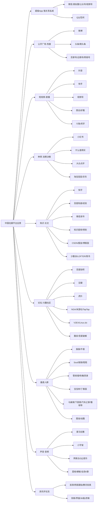
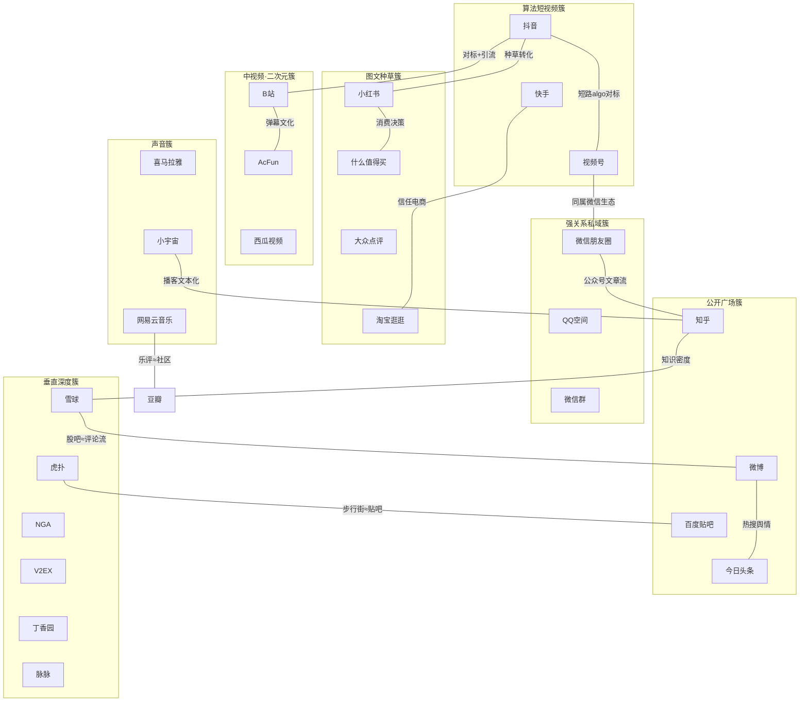
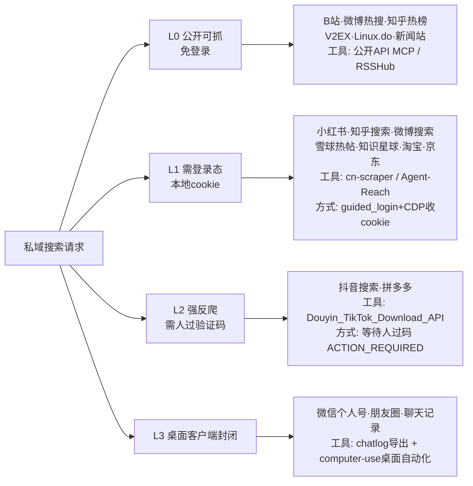

# 中国社媒平台全景与私域搜索调研报告

> 调研日期：2026-11-07 ｜ 方法：导航站（考拉新媒体导航、新榜导航）+ 多轮搜索（智谱联网）+ ModelScope MCP 目录 + GitHub 代码搜索 + 本地/远程 skill 市场
> 目的：为"搜索引擎增强版（可在私域搜索）"摸清 ①平台全景与聚类 ②各平台 MCP/skill 覆盖 ③更好的实践路径

---

## 一、结论速览

1. **平台全景**：中国社媒可归为 9 大类、约 110+ 活跃平台（见 §二）。真正的"私域孤岛"集中在：微信生态（公众号/视频号/朋友圈/群聊）、小红书、抖音、知识星球、淘宝京东评价区、封闭垂直社区（脉脉/Soul 等）。
2. **MCP 覆盖高度不均**：小红书（最卷，单项目 17k 星）、抖音、B站、微博、微信生态（公众号/视频号/微信读书）覆盖极厚；快手、豆瓣、雪球、知乎中等；贴吧、即刻、网易云勉强有；虎扑/NGA/脉脉/喜马拉雅/直播平台**基本空白**。
3. **聚合器 > 单平台**：私域搜索的最好实践不是"每平台装一个 MCP"，而是 3-4 个聚合器分层覆盖——Agent-Reach（109k★，读侧）、cn-scraper-mcp（中文私域全家桶）、reach-mcp（33 源一次查+热榜）、RSSHub（订阅基础设施）。
4. **skill 生态与 MCP 互补错位**：skill（Claude/OpenClaw 技能包）几乎全是"创作/发布/运营"向（小红书爆款笔记、抖音上传、公众号封面）；"检索/阅读"向的能力全部长在 MCP 侧。装检索能力 → 装 MCP；装创作能力 → 装 skill。
5. **私域可达性四层模型**（§五）：L0 公开可抓 → L1 需登录态（cookie 本地化是范本做法）→ L2 强反爬需人过验证码 → L3 桌面客户端封闭（chatlog + computer-use 兜底）。按层选工具，比按平台选更稳。

---

## 二、平台全景分类（大而全清单）

> 状态标注：● 活跃主流 ｜ ◐ 活跃但垂域/收缩 ｜ ○ 衰退/已停运（据公开信息，未逐一核验）
> "搜索可达性"指外部搜索引擎（百度/必应等）能否索引其内容——这是"私域程度"的直接判据

### 2.1 超级 App 与即时通讯（强关系私域）

| 平台 | 内容单元 | 搜索可达性 | 备注 |
|---|---|---|---|
| 微信-朋友圈 | 好友动态 | **完全私域** | 无任何公开入口 |
| 微信-公众号 | 图文长文 | **半私域**（搜狗/微信搜一搜部分收录） | 中文互联网最大内容池之一 |
| 微信-视频号 | 短视频/直播 | **私域** | 增长最快的内容板块 |
| 微信-搜一搜 | 全域搜索 | 站内 | 微信生态的"站内搜索引擎" |
| 企业微信/微信群 | 消息 | 完全私域 | chatlog 可导本地记录 |
| QQ/QQ空间 | 动态/群 | 半私域 | 年轻用户仍在 |
| 抖音-私信/粉丝群 | 消息 | 完全私域 | |

### 2.2 微博客 / 公开广场

| 平台 | 状态 | 内容单元 | 搜索可达性 |
|---|---|---|---|
| 微博 | ● | 短博文+热搜 | 站内搜索强，外部部分收录 |
| 今日头条/微头条 | ● | 资讯流+短内容 | 站内 |
| 百家号/企鹅号/网易号/搜狐号 | ◐ | 图文 | 部分收录 |
| 百度动态 | ○ | — | — |

### 2.3 短视频 / 直播

| 平台 | 状态 | 备注 |
|---|---|---|
| 抖音 | ● | 算法分发之王，搜索需登录+验证码 |
| 快手 | ● | 老铁关系链，API 生态薄弱 |
| 视频号 | ● | 微信生态，最封闭 |
| 好看视频/全民小视频 | ◐ | 百度系 |
| 皮皮虾/最右 | ◐ | 搞笑社区 |
| 西瓜视频 | ◐ | 中长视频并入抖音系 |
| 斗鱼/虎牙/YY | ◐ | 游戏直播 |
| 淘宝直播/抖音直播/快手直播 | ● | 电商直播 |

### 2.4 图文种草 / 消费决策（私域重灾区）

| 平台 | 状态 | 备注 |
|---|---|---|
| 小红书 | ● | 全球级种草社区，反爬最严（仅住宅 IP） |
| 什么值得买 | ● | 消费决策+优惠 |
| 淘宝逛逛/京东发现/拼多多 | ◐ | 电商内容化 |
| 大众点评 | ● | 本地生活评价（"中国 Yelp"） |
| 微店/有赞/云集 | ◐ | 社交电商 |

### 2.5 知识问答 / 长文 / 技术

| 平台 | 状态 | 备注 |
|---|---|---|
| 知乎 | ● | 中文长问答最大池，游客搜索已关闭 |
| 百度知道/经验 | ◐ | 老问答 |
| 微信读书 | ● | 书摘/笔记社区 |
| 得到/混沌/知识星球 | ● | 付费知识；知识星球=cookie 后的私域社群 |
| CSDN/博客园/掘金/SegmentFault | ● | 技术博客（掘金等有开放 API） |
| 少数派 | ● | 数字生活 |
| 简书/LOFTER | ◐ | 轻博客 |
| 维基/百度百科 | ● | 参考系 |

### 2.6 论坛 / 兴趣社区

| 平台 | 状态 | 领域 |
|---|---|---|
| 百度贴吧 | ● | 万能兴趣吧 |
| 豆瓣 | ● | 书影音+小组（文艺中枢） |
| 虎扑 | ● | 体育+直男社区 |
| NGA | ● | 游戏 |
| 米游社 | ● | 米哈游玩家 |
| TapTap/好游快爆 | ● | 手游社区 |
| V2EX | ● | 程序员（开放 API） |
| Linux.do | ● | 新锐技术社区（Discourse 系，API 开放） |
| 酷安 | ● | 数码 |
| 吾爱破解/远景/恩山/Chiphell | ◐ | 垂直极客 |
| 天涯/猫扑/凯迪 | ○ | 时代眼泪 |

### 2.7 垂直人群 / 场景社区

| 领域 | 平台 |
|---|---|
| 职场 | 脉脉 ●、看准网 ◐、牛客网 ●（求职） |
| 婚恋/陌生人 | Soul ●、探探/陌陌 ●、青藤之恋 ◐、世纪佳缘系 ◐ |
| 财经投资 | 雪球 ●、东方财富股吧 ●、集思录 ◐、富途/老虎社区 ◐ |
| 母婴 | 宝宝树 ◐、亲宝宝 ● |
| 医疗 | 丁香园 ●、好大夫 ◐ |
| 旅行 | 马蜂窝 ◐、穷游 ◐、携程社区 ◐ |
| 美食 | 下厨房 ●、豆果 ◐ |
| 汽车 | 汽车之家论坛 ●、懂车帝社区 ● |
| 体育 | 懂球帝 ●、直播吧 ● |
| 二次元/创作 | AcFun ◐、半次元 ◐、米画师 ●、快看漫画 ●、晋江/起点/番茄（小说评论/段评）● |
| 摄影/设计 | 图虫 ●、站酷 ●、花瓣 ◐ |

### 2.8 声音 / 音频

| 平台 | 状态 | 备注 |
|---|---|---|
| 喜马拉雅 | ● | 有声+播客 |
| 小宇宙 | ● | 播客社区（中文 Podcast Hub） |
| 网易云音乐 | ● | 评论区文化（乐评=内容） |
| QQ音乐/酷狗/酷我 | ● | 播放器+K歌（全民K歌/唱吧 ◐） |
| 荔枝/蜻蜓FM | ◐ | 电台 |

### 2.9 新闻资讯评论流（UGC 在评论区）

澎湃（问吧）、网易新闻（跟贴文化）、腾讯新闻（较真）、凤凰、界面、财新、36氪、虎嗅、钛媒体 —— 均为"专业内容+大众评论"结构，评论即舆情。

---

## 三、平台聚类关系图（graph 刻画远近）

### 3.1 全景分类树




### 3.2 核心平台远近关系图（内容形态 × 关系链 × 分发逻辑）

> 距离越近 = 内容形态、关系链、分发逻辑越相似。连线 = 可比对标/流量互通。




**聚类判读**（graph 想刻画的结构性事实）：

- **微信是横跨三个簇的奇点**：朋友圈（强关系簇）+ 视频号（短视频簇）+ 公众号（知识长文，与知乎同"深度阅读"带）——所以微信生态的 MCP 也是最碎片化的（6+ 个不同项目各管一块）。
- **"种草簇"是私域搜索价值密度最高的区域**：小红书/点评/值得买的内容直接影响消费决策，却几乎不被通用搜索引擎收录。
- **垂直深度簇是"高质量 UGC"的聚宝盆**（雪球/丁香园/NGA/V2EX），共同点是：反爬弱、API 相对友好（V2EX/Linux.do 官方 API 开放）——**是私域搜索性价比最高的一批**。
- **算法短视频簇最难搜**：内容在视频流里，文本化（ASR/OCR/字幕）是前置条件——这正是 LinkDigest/Agent-Reach 这类"链接转文字"项目存在的原因。

### 3.3 MCP 可达性分层图




---

## 四、逐平台 MCP / skill 覆盖对照表

> 星数=GitHub stars（2026-11-07 查询值）；MS=ModelScope MCP 广场也有收录

### 4.1 单平台 MCP

| 平台 | 覆盖度 | 代表项目（星数） | 能力 | 实现方式 | 关键限制 |
|---|---|---|---|---|---|
| **小红书** | ★★★★★ 极厚 | xpzouying/xiaohongshu-mcp（**17k★**）、iFurySt/RedNote-MCP（1.1k★）、aicu-icu/xhs-mcp-server（184★）；MS 上 30+ 个 | 搜笔记/读正文/评论/发布/多账号矩阵 | Playwright 登录 或 JS 逆向 x-s/x-t 直接 HTTP | 仅住宅 IP，云 IP 直接封 |
| **抖音** | ★★★★☆ 厚 | Evil0ctal/Douyin_TikTok_Download_API（**21k★**，含 MCP）、yzfly/douyin-mcp-server（1.3k★，已归档） | 无水印下载/文案提取/热榜/评论/私信 | 自愈身份池+PostgreSQL 归档 | 搜索需登录+滑块验证码 |
| **B站** | ★★★★☆ 厚 | adoresever/bilibili-mcp（183★）、huccihuang（193★）、34892002/bilibili-mcp-js（198★） | 搜索/视频信息/热门/**字幕/弹幕**/评论 | 公开 Web API，免登录 | 低频调用 |
| **微博** | ★★★★☆ 厚 | @Selenium39/mcp-server-weibo、@qinyuanpei/mcp-server-weibo（MS 1220 浏览）、红狐数据 | 搜用户/时间线/博文/评论/热搜 | REST+登录态（SUB token） | 搜索需登录，热搜免登录 |
| **微信-公众号** | ★★★★☆ 厚但分叉 | JupiterC/wechat_oa_mcp（MS 14353 浏览）、moyudashi/weixin_search_mcp（搜狗微信搜索）、sweesama/readgzh、MCPWeChatOfficialAccounts（MS 6358 浏览） | 两派：官方 API 派（发布/素材/消息管理） vs 爬虫派（搜文章/读全文） | 官方 MP API / 搜狗微信搜索+抓取 | 官方派要运营者权限；爬虫派受搜狗频控 |
| **微信-视频号** | ★★★☆☆ | socialdatax-wechat-channels-mcp、红狐 | 热榜/评论/创作者分析/作品提取 | 数据服务 API | 生态最封闭，依赖第三方数据商 |
| **微信-读书** | ★★★★☆ | @package/mcp-server-weread（MS **39440 浏览**，微信生态最高） | 书籍/笔记/划线数据 | 网页版 cookie | — |
| **微信-聊天记录** | ★★★☆☆ | chatlog（MS 收录） | 本地聊天记录检索 | PC 端数据库解密导出 | 仅历史记录，非实时 |
| **微信-个人号** | ★★☆☆☆ 灰色 | coolguy511/mcp-wechat-server | 收发消息 | 协议/WebSocket 逆向 | **封号风险高** |
| **知乎** | ★★★☆☆ 中 | we1005/zhihu-mcp、Douyh123/zhihu-mcp、JasonJarvan/Zhihu-Collections-MCP（187★ 收藏导出）、socialdatax-zhihu | 搜索/热榜/回答全文/评论/发布/收藏导出 | REST API v4 + 登录态 | 游客搜索已关闭 |
| **快手** | ★★☆☆☆ 薄 | DevinChen2014/kuaishou-mcp（SocialDataX）、fysh1010/kuaishou-mcp（水印） | 热榜/作品搜/评论/创作者 | 数据服务 API | 无社区级开源项目 |
| **豆瓣** | ★★★☆☆ 中 | jackjin1997/douban-mcp（15★）、moria97（13★）、BugenZhao/douban-mcp（Frodo API 逆向：搜索/登录/标记/评论） | 条目搜/详情/短评/个人收藏 | Frodo 移动端 API 逆向 | 搜索可能触发风控 |
| **百度贴吧** | ★☆☆☆☆ 极薄 | DevinChen2014/baidu-tieba-mcp（0★） | 帖子/用户搜索、楼中楼 | SocialDataX 数据服务 | 唯一一个，几乎无人维护迹象 |
| **雪球** | ★★★☆☆ 中 | liqiongyu/xueqiu_mcp（116★）、CNQQC/xueqiu-mcp（22 工具免配置）、baixianger/snowball-cli（25★） | 行情/财务/资金/社区帖/热股 | 行情免登录，社区需登录 | — |
| **即刻** | ★☆☆☆☆ 薄 | myartings/jikeskill（已归档）、StellarPanda、longhz（均≈0★） | 刷即刻/读动态 | 逆向 | 全部个人玩具级 |
| **网易云音乐** | ★★★☆☆ | Cheiineeey/netease-music-mcp（115★）、ELDment/Meting-Agent（118★，**多平台：网易云/QQ/酷狗/酷我**） | 点歌/歌词/歌单/搜索 | 网易云 API | 乐评深度抓取未见 |
| **小宇宙（播客）** | ★★☆☆☆ 间接 | 无独立项目；Agent-Reach 内置 xiaoyuzhou 转文字（需 Groq Key） | 播客语音转文字 | ASR | — |
| **V2EX** | ★★★☆☆ | funnythingfunnylove/mcp-server-v2ex（7★，API 2.0 全套） | 节点/帖子/回复/通知 | 官方开放 API | — |
| **虎扑/NGA/米游社/脉脉/Soul/喜马拉雅/斗鱼虎牙/站酷图虫** | ☆☆☆☆☆ **空白** | — | — | — | 脉脉/Soul 属实名/婚恋敏感区，短期也不会有 |
| **淘宝/京东/拼多多** | ★★★☆☆ | cn-scraper-mcp 内 taobao/jd（稳定）/pdd（不推荐）；xiaoyuaimaomao/EveryInfra（含 1688） | 商品搜/详情/价格 | curl_cffi MTOP 签名 / CDP | 拼多多每会话仅首次搜索 |
| **大众点评/知识星球** | ★★★☆☆ | cn-scraper-mcp 内 dianping/zsxq | 商户搜/评价；星球帖子/文章全文 | 公开解析 / cookie REST | 页面风控 |

### 4.2 聚合型 MCP（私域搜索的真正主力）

| 项目 | 星数 | 覆盖 | 定位 | 亮点 |
|---|---|---|---|---|
| **Agent-Reach** | **109k★** | B站/V2EX/GitHub/YouTube/web（默认）+ 小红书/雪球/BOSS直聘/小宇宙/LinkedIn/Reddit/X（可选）+ FB/IG（实验） | "让 Agent 够得着它上不去的互联网" | CLI+MCP；专用浏览器后台跑；**首选+备选有序工具列表**（上游失效自动换）；只读、从不代登录；零 API 费 |
| **cn-scraper-mcp** | 76★ | 淘宝/京东/拼多多/小红书/知乎/微博/抖音/B站/豆瓣/点评/知识星球 | 中文私域全家桶 | **guided_login 范式**：自动开 Chrome→你扫码→CDP 收割含 HttpOnly 的 cookie 存本地 `~/.cn-scraper-cookies/`；cookie 不进日志不回传；ACTION_REQUIRED 统一等待人工结构 |
| **reach-mcp** | 10★ | **33 源**：小红书/微博/知乎/豆瓣/头条/linux.do/B站/X/Reddit/IG/Threads/TikTok/YouTube/Pinterest/Bluesky/LinkedIn/quora + GitHub/HN/V2EX/RSS/arXiv + 雪球/Truth Social + 小宇宙 + 各家热榜 | 一次查询全网横扫 | 热榜聚合最全（微博/知乎/头条/linux.do/B站/X trends/GitHub 周榜） |
| **omniseek** | 98★ | 播客/视频/B站/V2EX/知乎/Reddit/HN/arxiv | "web search 搜不到的那部分互联网" | 登录站用你自己的登录、默认关闭；跨语言 |
| **EveryInfra（万有引擎）** | — | 小红书/抖音/淘宝/京东/1688/B站/微博/公众号 | 社媒+电商数据 | MS 广场在列 |
| **LinkDigest** | — | 小红书/抖音/B站/微博链接→文本 | 视频内容可读化 | 转录/OCR/字幕/元数据 |
| **china-news-feed-mcp** | 0★（archived） | 微博/百度/知乎/头条/抖音/B站/快手热榜 + **删帖观察** | 舆情时钟 | 删帖监测是独门 |
| **zenfeed** | 1.7k★ | RSSHub 兼容一切源 | AI RSS 阅读器（MCP） | 订阅式持续观测 |
| **AiToEarn / Easel** | 27k★ / 4.4k★ | 抖音/快手/视频号/小红书/知乎/B站（发布侧） | 多平台一键发布 | 写侧聚合（与读侧互补） |

### 4.3 skill 覆盖

| 层 | 发现 | 判读 |
|---|---|---|
| Claude Code 常见默认环境 | 无任何中国平台 skill（官方 skill 生态以英文平台为主，如 x-api 之于 X/Twitter） | 检索缺口普遍存在 |
| SkillHub 官方市场 | "小红书爆款笔记全链路"（运营操作系统：选题/标题/封面/SEO/复盘/合规 333 敏感词）等 | **创作·运营向** |
| 虾评市场 | AI油画大师（小红书素材向）、新闻早晚报（54 RSS 源+社媒采集） | 创作+资讯简报向 |
| GitHub | autoclaw-cc/xiaohongshu-mcp-skills（277★）、WJZ-P/douyin-upload-mcp-skill（OpenClaw）、jikeskill（即刻，OpenClaw）、beatra-ai/wechat-article-cover-skill、Easel（agent-skill） | 形态=MCP 的"使用说明书封装" |

**结论**：skill 层管"怎么把内容做出来发出去"，MCP 层管"怎么把内容读进来搜出来"——想搭私域搜索引擎，装 skill 帮不上忙，核心是 §4.2 的聚合 MCP。

---

## 五、"搜索引擎增强版"的更好实践（分层架构建议）

### 5.1 可达性四层模型（按层选工具，不按平台选）

| 层 | 特征 | 平台 | 工具策略 |
|---|---|---|---|
| **L0 公开可抓** | 免登录即读 | B站、微博热搜、知乎热榜、V2EX、Linux.do、新闻站、技术博客 | 公开 API MCP / RSSHub；一次配置长期有效 |
| **L1 需登录态** | cookie 后才给搜 | 小红书、知乎搜索、微博搜索、雪球热帖、知识星球、淘宝京东 | **cn-scraper 式本地 cookie**（guided_login + CDP 收割 + 本地存储 + 不回传）；专用小号 |
| **L2 强反爬** | 验证码/风控墙 | 抖音搜索、拼多多、豆瓣部分接口 | MCP 内置 ACTION_REQUIRED（等 120s 人过码再自动继续）；要有失效预期 |
| **L3 桌面封闭** | 无 Web 端或强加密 | 微信个人号、朋友圈、聊天记录 | chatlog（历史导出）+ **computer-use 桌面自动化**（可操作微信 PC 客户端的搜一搜）——私域搜索的最后兜底 |

### 5.2 推荐架构（对"增强版搜索引擎"的具体提案）

```
用户查询
  │
  ├─ ① 通用层：联网搜索 MCP（智谱/博查/Exa）—— 先摸公域
  │
  ├─ ② 私域路由层：查询分类 → 按平台/层路由
  │     ├─ L0 → RSSHub / 公开 API MCP
  │     ├─ L1 → cn-scraper-mcp / Agent-Reach（登录态渠道）
  │     ├─ L2 → 抖音专用 MCP（人过码）
  │     └─ L3 → computer-use 桌面操作
  │
  ├─ ③ 热榜层：reach-mcp 一次拉各家热榜（"现在全网在热什么"）
  │
  ├─ ④ 读链层：LinkDigest / Agent-Reach 把视频·播客转文字（私域内容可读化）
  │
  └─ ⑤ 订阅层：RSSHub + zenfeed（把"搜索"变"监控"——重复性信息需求走订阅，不占查询）
```

### 5.3 风险与纪律（照搬成熟项目的做法）

1. **只读优先**：Agent-Reach 明确"不发帖不评论不点赞不私信"——检索型 agent 应恪守。
2. **账号安全**：登录态只存本地、绝不交给远程聚合服务；用小号；cookie 不进日志不进 MCP 返回值（cn-scraper 的安全设计是范本）。
3. **失效是常态**：平台改版/反爬升级会让任何单点 MCP 随时死——采用 Agent-Reach 的"首选+备选有序工具列表"思想，工具层可替换、上层用法不变。
4. **合规**：所有抓取仅学习研究用途，批量抓取可能违反平台 ToS；频率克制；实名/婚恋平台（脉脉/Soul）不该也不必有 MCP。
5. **系统资源**：Playwright/Chrome 常驻会吃内存，低配机器注意。

---

## 六、遗留观察

- **百度贴吧 MCP 几乎空白**是个意外发现：万亿级老社区，但抓取生态死寂（吧页结构老旧+百度风控），值得注意"平台年龄 ≠ 工具生态"。
- **微信读书 MCP 浏览量（39k）是微信生态最高**，超过公众号——AI 阅读场景的真实需求信号。
- **删帖观察**（china-news-feed-mcp）是被低估的能力：舆情类私域搜索里"内容消失"本身是信息。
- 海外侧对标：RedNote（小红书海外版）在 2026 年的全球热度让"XHS 系"工具（xpzouying 17k★、RedNote-MCP）成为整个中文 MCP 生态里星数最高的赛道。

## 七、来源

- 导航站：考拉新媒体导航（kaolamedia.com）、新榜新媒体导航
- 搜索：智谱联网搜索（社媒分类/论坛盘点/职场婚恋专题，2026-11-07）
- MCP 目录：ModelScope MCP 广场（微博/小红书/知乎/微信 逐词检索）
- 代码：GitHub search（xiaohongshu/zhihu/bilibili/douyin/wechat/kuaishou/douban/tieba/xueqiu/jike/netease/rsshub/v2ex × mcp，2026-11-07 星数快照）
- 精读 README：Agent-Reach（109k★）、cn-scraper-mcp（76★）
- skill 市场：SkillHub（lightmake.site）、虾评（xiaping.coze.com）
