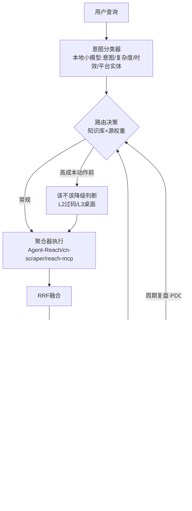

# 私域搜索引擎（感知层路由器）：产品调研与概念设计

> 2026-11-07 ｜ 承接《中国社媒平台全景与私域搜索调研报告》§五（聚合器优于单平台）
> 本文档回答：聚合器之上的路由层怎么建。三项前置：①场景 benchmark 与基线 ②业界现成实践盘点 ③搜索引擎工程知识继承映射
> 状态：概念设计 v0.1。路线图见 §7

---

## 0. 一页结论

1. 要建的不是"又一个搜索产品"，是**宿主侧的感知层路由器**：查询 → 意图解析 → 源选择 → 聚合器执行 → 充分性判断 →（不够则补查/降级）→ 反馈账本。
2. 业界四级路由地图：**工具级**（MCP 网关，成熟）、**模型级**（选 LLM，成熟）、**语料级**（选知识库，2026 刚起步）、**源级**（query→私域平台，**空白**）。我们要做的是最后一级，且前三级的成果大量可继承。
3. 最大的两笔可继承资产：学术线 **Adaptive-RAG**（小模型复杂度分类器 → 分级检索策略）就是意图路由器的原型；工程线 **RRF 融合**（按排名融合多源结果，免调参）就是多源聚合的现成算法。
4. Benchmark 先行且站在业界肩膀上（§3.0 盘点 12 项成果）：出题哲学抄 **BrowseComp**（题目刻意选通用搜索搜不到的）、信度设计抄 **CRAG**（离线快照源防漂移）、诊断拆分抄 **FRAMES**（路由/检索/答案分环归因）、人工量表抄 **Google Quality Rater**（Needs Met 分级 + side-by-side 对比）、闭环模式有 **Perplexity 工业实证**（规则集评估循环与我们的反馈账本同构）、中文素材锚定 **WebCPM/DuReader**。自有新东西只剩四维：**平台可达性、源路由、配置成本、降级链**——业界基准都没有。
5. 基线设计：跑两条——**基线 A**（LLM+通用联网搜索直答）测"私域路由的价值增量"；**基线 B**（LLM 自持全部聚合 MCP 自由决策）测"专职路由层值不值得做"。

---

## 1. 问题定义与相近事物区分

路由层 = 把"我该去哪儿找"从 LLM 的临场发挥中拿出来，变成**显式的、可评测的、可自我改进的决策层**。

### 1.1 四级路由地图（"相关但不同"的严格区分）

| 级 | 路由对象 | 代表 | 成熟度 | 与本设计的关系 |
|---|---|---|---|---|
| 工具级 | tool call → 哪个 MCP server | higress MCP router、mcp-gateway | 成熟 | 可作执行层底座，但不做意图语义、不管信息质量 |
| 模型级 | query → 哪个 LLM | RouteLLM、LLM Bandit（arXiv 2502.02743）、contextual bandit 系（2510.07429） | 成熟 | **方法论直接迁移**：把"臂"从模型换成信息源，奖励从答案质量换成充分性 |
| 语料级 | query → 哪个知识库/语料 | RAGRouter-Bench（arXiv 2602.00296，2026 首个基准） | 刚起步 | benchmark 设计可借鉴（query-corpus compatibility），但闭域静态语料 vs 开域动态平台 |
| **源级（本设计）** | **query → 哪个平台/聚合器/工具** | 无（reach-mcp 只做全源扇出；Agent-Reach 只做链接→渠道单跳） | **空白** | 独有维度：平台可达性（登录态/风控/住宅IP）、按意图的充分性判据、跨源反馈闭环 |

### 1.2 另外三个必须区分的东西

- **Deep Research 框架**（LangChain Open Deep Research、GPT Researcher、STORM、DeerFlow）：解决"研究流程编排"，但源默认是通用 web 搜索 API——没有私域平台路由概念。我们的路由层可以**作为它们的 source 插件**反向集成。
- **reach-mcp 的 33 源扇出**：无路由的全源并发+事后筛，查询成本随源数线性涨；路由层要取代的正是这种"撒网式"。
- **传统搜索引擎的垂直路由**：Google/百度内部"这条 query 给网页/图片/购物/地图"——**与我们的问题同构**，是知识继承的主体（§4）。

---

## 2. 业界现成实践盘点（deep research 结果）

### 2.1 学术线：agent 时代的新知识

| 成果 | 核心思想 | 对本设计的可继承点 |
|---|---|---|
| **Adaptive-RAG**（2024，引 1062+） | 小 LM 做查询复杂度分类 → 决定 不检索/单步/多步 | **意图分类器的学术原型**；分类器刻意用小模型（便宜、快）——本地判断模型可胜任的证据 |
| **Self-RAG**（引 4121+） | 生成中自反思：检索质量如何、要不要再检 | 反思信号的设计参考（何时补查） |
| **Search-R1**（RL 系） | 强化学习教会 agent 只在内部知识不足时才搜索 | "要不要检索/该不该降级"的判断可以学出来，不靠硬编码 |
| **信息觅食理论 + RL**（Search-R1 同族） | 把检索形式化为动态信息搜寻，奖励中间检索质量 | 反馈账本的奖励信号设计 |
| **Deep Research Agents 综述**（2025-09） | DR agent 五大核心组件（搜索引擎集成等） | 组件切分的参考框架 |
| **FlowSearch**（2026） | 动态检索路径规划 | 多跳路由的路径观 |
| **RAGRouter-Bench**（2026） | 首个自适应 RAG 路由数据集与基准 | benchmark 的字段设计与基线组织方式 |
| 维度覆盖早停法（《AI Agent 开发实战》第27章） | 每轮检索后评估维度覆盖度，空白维度补搜，全覆盖即停 | **充分性判据的通用模板**：判据 = 维度集合 × 每维阈值 |

### 2.2 工程线：搜索引擎的旧知识（60 年家底）

| 组件 | 成熟做法 | 备注 |
|---|---|---|
| 查询理解 QU | 词法/句法/语义三层解析；意图分类（规则模板+ML 混合起家）；query 改写 | 意图分类"先规则后模型"的混合策略是被验证的工程路线 |
| 垂直路由 | query → 垂域（购物/地图/新闻…），大类先分再细分 | 与平台路由同构 |
| 结果融合 | **RRF 倒数排名融合**：只用各源排名不用原始分，免调参，专治异构源分数不可比 | 多聚合器结果合并的现成答案 |
| 评测 | NDCG/相关度标注/interleaving 对比实验 | benchmark 的方法论底座 |
| 缓存与新鲜度 | 分层缓存、TTL、热点探测 | 查询缓存+源健康缓存直接照搬思想 |

### 2.3 MCP 生态的聚合实践

- 网关/聚合模式已收敛（"5 种架构模式 4 个反模式"，2026-07）：**Proxy Aggregator 模式**明确警告"按需检索工具而非一股脑合并"——工具数量爆炸是真实反模式，印证"宿主侧路由层"的必要性。
- Agent-Reach 的"**首选+备选有序工具列表**"（上游失效自动换）：降级链设计的现成范式，直接继承。

### 2.4 空白确认

源级路由的三件套在现有开源界均无现成实现：①平台可达性建模（登录态有效期/风控等级/住宅 IP 约束的结构化表达）②按意图类型的充分性判据表 ③跨源反馈→路由权重的闭环。这三件就是本设计的全部自有工作量，其余皆是继承。

---

## 3. Benchmark 概念设计（先行件）

### 3.0 业界 benchmark 成果盘点（先继承再造轮子）

**agentic 搜索评测三代脉络**：静态 QA（GLUE/MMLU 已被解决）→ RAG 评测（FRAMES/CRAG/SuperCLUE-RAG，分能力测）→ agentic 检索评测（BrowseComp/GAIA/DeepResearch Bench，考"找的过程"）。我们处在第三代语境下，但面向私域源。

| 基准/材料 | 机构与年代 | 核心设计 | 我们继承什么 |
|---|---|---|---|
| **BrowseComp / BrowseComp-Plus** | OpenAI 2025-04 / Plus 2025-08（引 233） | 1266 道"刻意难"题：答案短小可自动判分，但直接搜索搜不到（GPT-4o 裸考仅 1.9%）；Plus 修正为**固定人工验证语料** | 出题哲学：答案短+可自动判+题目本身就在测"必须去私域找"；Plus 教训 = 固定参照语料防评测环境漂移 |
| **FRAMES** | Google 2024（引 262，HF 开源） | 824 道手写多跳题，**事实性/检索/推理三能力分开评** | 诊断性拆分：路由错、检索空、答案弱要能区分归因 |
| **FACTS Benchmark Suite** | Google DeepMind 2025-12 | 事实性系统评测，含"Search as a tool"维度 | Google 官方最新动向：把"会用搜索"本身当被测能力 |
| **CRAG** | Meta+HKUST 2024（引 208，KDD Cup 2024） | 4000+ QA，**垂直域混合出题（网页/地图/股票）+ 模拟商业搜索 API** | ①垂直域混合 = 我们六类意图的范本；②**模拟 API/模拟源保信度**——L0 层评测可用离线快照源，根治"私域源不稳定"的信度风险 |
| **GAIA** | Meta/HF 2023 | 工具增强通用助手基准 | 多工具环境的任务设计参考 |
| **DeepResearch Bench（II）** | ICLR 2026（引 271），Mercor 运营榜 | 100+ 领域专家出题（PhD 级×22 领域）；**报告生成与检索能力分开评**；LLM judge | 专家出题模式（人工+AI 协作出题）；双维评测结构 |
| **Deep Research Gym** | 2025 | 真实搜索引擎环境 + Researchy Questions + LLM-as-judge | "给评测配真实检索环境"的工程做法 |
| **Google Quality Rater Guidelines** | Google 官方（170+ 页，2023-11/2025-01 更新） | 人工评分体系：**Needs Met（满足需求）量表**、Page Quality（E-E-A-T）、**side-by-side 对比任务** | ①充分性判据的人工版模板（"满足需求"分级比二值判据更细）；②三基线对比直接用 side-by-side 呈现；③2025 版新增的 filler/paraphrased 内容判罚 = 答案质量评分项 |
| **Perplexity 官方材料** | 2025-09 / 2025-11 / 2026-04 | ①Search API 基准测试框架（质量×速度权衡）；②**规则集评估闭环**：LLM 从完整性+质量评当前规则集→提议变更→验证→部署；③搜索智能体后训练流水线（**数据策展与奖励设计协同**） | ②是我们"反馈账本→周期复盘"的工业实证（同构！）；①的"质量-速度权衡"框架进成本维度；③为长期路线背书 |
| **WebCPM / DuReader** | 清华 THUNLP 2023 / 百度 | 首个中文交互式搜索 LFQA 数据集（真实用户搜索行为记录） | 中文题目素材与行为分布参照；其中文搜索交互工具链可复用为评测环境部件 |
| **SuperCLUE-RAG / AgentCLUE** | SuperCLUE 2024- | 中文原生 RAG 测评 / 中文 agent 基准 | 国内评测生态对标（若日后对外发布结果，对齐其口径） |

**三条总教训**（业界用真金白银换的）：

1. **评测环境漂移是头号敌人**：BrowseComp 出题依赖活网页 → Plus 改固定语料；CRAG 干脆用模拟 API。我们的对应：L0 层判据配离线快照源，L1-L3 层判据只写结构不写内容。
2. **能力分维度诊断 > 总分**：FRAMES 三拆、DeepResearch Bench 两拆——否则赢了不知道为什么赢，输了不知道错在哪环。
3. **工业界的评估都是闭环**：Perplexity 的规则集评估循环证明"评测→改策略→再评"不是学术装饰，是产品运转方式——我们的反馈账本设计因此有底气。

### 3.1 设计原则

1. **判据结构化而非内容快照**：私域内容时效强，题目判据不能依赖"某天某帖的具体内容"，要依赖可复验的结构（如"近 30 天评价 ≥3 条且跨 2 平台"）。（BrowseComp-Plus/CRAG 教训）
2. **评测中间环节**，不只评最终答案（七层 agent 评测 + FRAMES 诊断性拆分的启发）：路由错没错、补查触发对不对，比答案对错更能暴露系统行为。
3. **能力分维归因**：每题结果拆"路由/检索/融合/答案"四环记录，输出错误归因分布，不只给总分。
4. **对比实验用 side-by-side 呈现**（Quality Rater 方法）：三系统同题输出并列，人工抽检一成样本。
5. 基线先行：路由层一行代码没写之前，基线就能跑——这是"benchmark 先行"的本意。

### 3.2 场景集：六类意图 × 难度 × 可达层

| 意图类型 | 示例查询 | 预期主源（举例） | 充分性判据模板 | 时效 |
|---|---|---|---|---|
| 事实核查 | "XX 品牌最近是否召回过某型号" | 微博、头条、新闻站 | ≥2 独立源一致 | 高 |
| 口碑评价 | "某款儿童学习桌真实用户怎么说" | 小红书、什么值得买、京东评价 | ≥3 条评价跨 ≥2 平台 | 中 |
| 价格行情 | "某 GPU 当前散件价格区间" | 淘宝、京东、值得买 | ≤7 天时效 + ≥2 商家报价 | 高 |
| 热点追踪 | "今天中文互联网在热什么" | reach-mcp 热榜聚合 | 覆盖 ≥5 家热榜 + 交叉 ≥2 家同题 | 极高 |
| 深度调研 | "某公司近期组织调整的脉络" | 公众号、知乎、脉脉、36氪 | ≥4 维度各 ≥1 源（事实/时间线/当事方/影响） | 中 |
| 找人找号 | "某领域值得关注的创作者" | 小红书、B站、即刻 | 每平台 ≥1 账号 + 粉丝量级核实 | 低 |

- 难度轴：单源可答 / 需跨源 / 需时效敏感 / 需多跳（A 的结果决定去哪查 B）
- 可达层轴：L0 公开源题、L1 登录态题、L2 强反爬题、L3 桌面兜底题——**每层都要有题，专门测降级链**
- v0 规模：**36 题**（6 类 × 6 题，覆盖 4 个可达层），JSONL 格式，字段：`{query, intent, expected_sources[], sufficiency_rule, freshness, layer, difficulty, snapshot_ref}`
- 定位一句话：**私域版 BrowseComp**——题目刻意选"通用搜索直接搜不到"的信息需求（这正是 BrowseComp 的出题哲学），但我们的难点来自平台封闭性而非网页深处。
- 信度设计（CRAG 教训）：每道 L0 题配**离线快照参照源**（`snapshot_ref` 指向本地存档），线上源漂移不毁题；L1-L3 题判据只写结构。

### 3.3 评测维度（五维）

| 维度 | 测什么 | 怎么测 |
|---|---|---|
| **路由准确率** | 选中源是否 ∈ 预期源集合 | 轨迹对照（中间环节） |
| **充分性达成率** | 返回信息是否满足判据模板 | 规则判定（判据本身结构化）；人工抽检时用 Quality Rater 的 Needs Met 分级（完全满足/部分满足/不满足）而非二值 |
| **答案质量** | 端到端答案的忠实度/完整度 | LLM-as-judge（固定评审模型并记录版本）；评分维度含 Google 2025 判罚项：filler（凑字）/paraphrased（仅复述无综合） |
| **成本** | token、耗时、调用次数、**人工干预次数**（过验证码/扫码） | 账本统计；配置成本单独记（用户要求零/单次配置） |
| **鲁棒性** | 主源失效后降级成功率 | 混沌测试：人为注入 cookie 过期/源超时 |

### 3.4 基线设计（以 LLM 直接检索为基线）

| 系统 | 构成 | 测什么问题 |
|---|---|---|
| **基线 A** | LLM + 通用联网搜索（智谱）直答，无私域工具 | A vs C = **私域路由的价值增量**（通用搜索够不够用） |
| **基线 B** | LLM 自持全部聚合 MCP（Agent-Reach + cn-scraper + reach-mcp），自由决策 | B vs C = **专职路由层 vs 临场自由发挥**（harness 设计的经典问题） |
| **对照 C** | 目标系统（路由层 v0） | — |

- 跑法：36 题 × 三系统 × 各 3 次，记录五维指标；B 的 token 消耗上限要预设（成本风险）。
- 判读预设：若 A 在口碑/价格/找人三类意图上系统性输给 B/C，即证明私域路由有真价值；若 B ≈ C，则路由层应退化为一纸提示词（skill 化足够），不必上工程——**benchmark 的结果直接决定形态选择**。

---

## 4. 搜索引擎工程知识继承映射（买 vs 造总表）

| 路由器组件 | 继承自 | 具体来源 | 买/造 |
|---|---|---|---|
| 意图分类器 | 查询理解（QU）+ Adaptive-RAG | 先规则（关键词/平台实体词典）后小模型（本地判断模型），复杂度分级输出 | **造**（prompt 工程，无训练） |
| 平台路由知识库 | 垂直路由 | 种子 = 主报告 §二 的 110+ 平台分类表 + §三 可达性分层图 | **造**（一次人工 + 持续复盘更新） |
| 执行层 | MCP 网关聚合模式 + Agent-Reach | Agent-Reach / cn-scraper / reach-mcp / RSSHub / computer-use 兜底 | **买**（现成） |
| 多源融合 | RRF | 按排名融合，免调参；可选 LLM 重排 | **买**（算法拿来即用） |
| 充分性判据 | 维度覆盖早停 + RAG 评测指标（Context Relevance/Recall） | 按意图类型的"维度 × 阈值"模板表 | **造**（规则模板 + LLM judge 兜底） |
| 降级链 | Agent-Reach 首选+备选有序列表 + Self-RAG 反思 | 每动作的工具链降级序；高成本动作（L2 过码/L3 桌面）前强制判断 | 半买半造 |
| 反馈账本→权重 | Bandit 路由（2502.02743 / 2510.07429） | 臂=源，奖励=充分性达成-成本；ε-greedy 起步，不搞 RL | **造**（轻量脚本） |
| 查询/健康缓存 | 分层缓存 + TTL | 源健康缓存含 cookie 有效期预测 | **造**（轻量） |

---

## 5. 概念架构 v0（数据流）

- **复盘回路**是本设计与"撒网式聚合"的本质区别：账本按周复盘，改的是源权重与路由表，不动代码——一个小模型就能承担的轻量 PDCA 循环。**工业实证**：Perplexity 的搜索规则集就是同构循环（LLM 从完整性+质量评估规则集 → 提议变更 → 验证 → 部署，见其 2025-11 工程文章）——这条路在产品侧被验证可行。
- 配置体验：L0 源零配置；L1 源单次引导登录（沿 cn-scraper 模式）；L2/L3 动作前必须显式请示（人工成本不可隐藏）。

## 6. 风险与开放问题

1. **基准信度**：私域源本身不稳定（源死了题目还在）→ 判据只写结构不写内容快照；每季度人工复核题目有效性。
2. **LLM-as-judge 偏差**：评审模型固定版本、双评委不一致时人工仲裁一成样本。
3. **基线 B 成本**：自由发挥型 agent 可能烧 token——预设单题预算上限，超限记失败（这本身也是数据）。
4. **合规**：沿主报告 §5.3 纪律（只读优先/小号/本地 cookie/频率克制）。
5. **"零配置"的诚实边界**：L1 源的单次登录配置不可避免，应把"配置次数"作为指标公开度量，而非宣称绝对零配置。

## 7. 路线图

| 步 | 内容 | 说明 |
|---|---|---|
| 1 | benchmark v0：36 题出题 + 双基线实测 | 出题规格见 §3（六类意图 × 六题 × 四可达层，判据结构化 + L0 题配快照源）；基线 A=LLM+通用搜索直答，基线 B=LLM 自持全部 MCP。跑通即回答两个根本问题：私域路由的价值增量有多大、专职路由层值不值得建 |
| 2 | 路由器 v0 | 形态（一纸提示词级 skill / 独立服务）由第 1 步的基线 B vs 路由层数据决定——数据不大就轻做，差距大才上工程 |
| 3 | 意图分类器本地化 | 路由层的意图分类由本地小模型承担（Adaptive-RAG 已证明小模型分类器可行），降低单次查询成本与外部依赖 |

## 8. 来源

- 学术：Adaptive-RAG（NAIR 2024）、Self-RAG（Asai 2023）、Search-R1 及 RL agentic search 综述（2025-11）、FlowSearch（2026）、Deep Research Agents 综述（2025-09）、RAGRouter-Bench（arXiv 2602.00296）、LLM Bandit（2502.02743）、Learning to Route from Bandit Feedback（2510.07429）、Adaptive LLM Routing Under Budget Constraints
- 基准（2026-11-07 补充调研）：BrowseComp（OpenAI 2025-04）、BrowseComp-Plus（arXiv 2508.06600）、FRAMES（Google 2024，arXiv 2409.12941，HF: google/frames-benchmark）、FACTS Benchmark Suite（Google DeepMind 博客 2025-12）、CRAG（Meta+HKUST，arXiv 2406.04744，KDD Cup 2024）、GAIA（Meta/HF）、DeepResearch Bench（ICLR 2026，引 271；二代榜由 Mercor 运营）、Deep Research Gym、WebCPM（THUNLP，arXiv 2305.06849）、DuReader（百度）、SuperCLUE-RAG（2024-04）、AgentCLUE
- 大厂官方：Google Quality Rater Guidelines（raterhub 170+ 页，2023-11 与 2025-01 更新版）、Google Search 严格测试页（side-by-side 说明）、Perplexity 工程材料三篇：Search API 评估框架（2025-09）、搜索规则集评估闭环（2025-11《Perplexity 如何打造AI搜索》）、搜索智能体后训练流水线（2026-04《推进搜索增强语言模型》，数据策展×奖励设计协同）
- 工程：MCP 架构模式与反模式（2026-07）、higress/mcp-gateway、LangChain Open Deep Research、GPT Researcher、STORM、12 自托管 DR 工具对比（2026-08）、Agent-Reach README、cn-scraper-mcp README、RRF（Elasticsearch/LanceDB/Milvus 文档）
- 中文工程：查询理解三部曲（极客时间）、达观搜索意图识别、前沿重器 query 理解系列、七层 agent 评测体系（2026）
